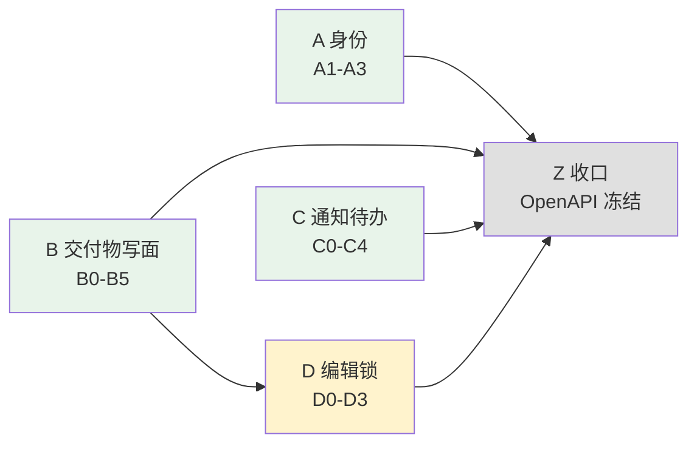

# P9A 实施计划（交付物写面 + 身份模型 + 观测层 + 通知待办 + 编辑锁）

> **For agentic workers:** REQUIRED SUB-SKILL: superpowers:subagent-driven-development 或 superpowers:executing-plans。步骤用 `- [ ]` 语法追踪。

**Goal:** 把 P1/P7/P8 已建好但**没有出口**的交付物模型与 service 接成 P9B 可消费的 API，并补 2 张新表、2 个新列、编辑并发保护。

**Architecture:** P9A **不是从零建 34 件事**。实测：8 张交付物相关表已存在于 ORM、4 个 service（约 1900 行，各有约 450 行测试）已实现业务逻辑但**无任何 API 出口**。P9A = ①补 2 张新表 + 2 个新列；②把已有 service 接成端点；③建身份/观测/通知/编辑锁四条横切线；④冻结 OpenAPI。

**本文件是总纲（hub），不是可执行计划。** 16 个 task 按依赖拆成 **4 份可执行计划**
（2026-10-19 `/plan-eng-review` Step 0 复杂度闸门裁决：16 task / 8 新模块 / 22 文件
远超阈值）。共享约束只在总纲写一遍，各 lane 文件不重复。

**Tech Stack:** FastAPI · SQLAlchemy 2.x async · alembic · Redis(锁) · ARQ(清理) · WebSocket · pytest · vitest

**Spec:** `spec/PCS-REQ-2026-002-SPEC-P9 …（修订版）` §第三部分（P9A 后端）
**架构依据:** `docs/adr/0046-0049`（4 份 accepted）+ 2026-10-19 三条开工裁决

---

## ⚠️ 开工前必读：SPEC 与代码的真实差距

SPEC §3 写的是「交付物子系统全套 service + API + 迁移」。实测（2026-10-19）：

| SPEC 假设 | 实测 | 对计划的影响 |
|---|---|---|
| 需新建 Deliverable/SignatureMatrix 模型 | **已存在** 8 张：`deliverables` / `deliverable_versions` / `deliverable_record_bindings` / `signature_matrices` / `project_signature_matrix_bindings` / `customer_approval_attachments` / `change_notice_details` / `record_change_snapshots` | T4~T7 **只接出口**，不建模型 |
| 需新建业务 service | **已存在** 4 个：`change_notice_service`(403行) / `reversal_approval_service`(331行) / `record_cancellation_service`(240行) / `deliverable_service`(169行，仅4个读方法) | 同上，各带约 450 行测试 |
| 无 API 出口 | **实测确认**：前三个 service `grep app/api/` → **0 引用** | 这才是 P9A 的主要工作量 |
| `users` 表 0 行、无代码写入 | 确认（`app/models/project.py:135`） | T1~T3 |
| `workflow_progress` / `notifications` | **0 命中**，确需新建 | T1 |
| P9A 4~6 周 | 形态比 SPEC 假设好，但**新增横切线（通知/编辑锁/WebSocket）不在 SPEC 原估算里** | 见「尚未解决」1 |

**已有 service 与 SPEC 端点的映射**（决定了哪些是「接线」哪些是「新建」）：

| SPEC 端点 | 已有实现 | Task |
|---|---|---|
| `POST /records/{m}/{id}/obsolete` | `record_cancellation_service.obsolete` (`:126`) | T7 接线 |
| `POST /records/{m}/{id}/request-reversal` | `reversal_approval_service.request_reversal` (`:106`) | T7 接线 |
| `POST /records/{m}/{id}/reversal-decision` | `reversal_approval_service.approve_reversal`(`:194`) / `reject_reversal`(`:260`) | T7 接线 |
| `POST /records/{m}/{id}/abandon-change` | `change_notice_service.approve_change_notice` (`:267`) + `_apply_record_resolution`(`:360`) | T7 接线（**开工时先核对语义是否等同**） |
| `submit-approval` / `approval-step` / `comments` | 无 | T7 新建 |
| `GET /deliverables/{id}/actions` | 无 | T7 新建（数据源待定，见「尚未解决」2） |
| `POST /deliverables/{id}/issue` | 无（`numbering_service.next_value` 可复用） | T4 新建 |
| `POST /deliverables/{id}/sign-step` | 无 | T5 新建 |
| `POST /deliverables/{id}/customer-approval/proxy` | `customer_approval_attachments` 表已在 | T6 新建 |

---

## Global Constraints

- **迁移纪律**：ORM 写 `ForeignKey(..., use_alter=True)` **不生成迁移**（bug-146）。每批迁移后跑 `uv run alembic check`，退出码 **255 不是 1**。**每库各跑一次**（CLAUDE.md 读法③）。
- **零裸字段**（P9A-DLV-010）：每个新端点的响应模型**必须显式声明**。禁止 `response_model=dict` / `object`。基线 71，`check_openapi_payload_coverage.py` 只拦倒退。
- **退出码观测**：跑子命令一律用 `scripts/run_gate.py`，**不要**自己 `$?`（TODO-050，255 陷阱已进 CLAUDE.md）。
- **写入层**：观测/审计写入必须在 **service 层**，不得写在 `app/api/v1/*` 路由里（ADR-0047 §① 🔒 —— 状态机有一条 ARQ cron 入口完全不经过 API 层，写在 API 层会让 cron 驱动变更在观测层系统性隐形）。
- **不用内存态做跨进程共享**：编辑锁走 Redis、吊销走 `users.token_version`、并发令牌只 `record_hash` 一套。禁止 `row_version`（会造第二套令牌）、禁止内存黑名单（TODO-047 同构陷阱）。
- **mock 不落库**：`/auth/mock-login` **不得**写 `users` 表（ADR-0046 §③b）。
- **`token_version = 0` 是保留值**，真实用户永不为 0 ⇒ `CHECK (token_version >= 1)`。
- **不得在 `state_machine.py` 内部埋点**（ADR-0047 §③）。
- **提交约定**：每 task 末尾一个 commit，conventional commits，**无 attribution 行**（本仓全局禁用）。

## Review Focus

以下 7 条是本阶段最可能咬人的，每条在所属 task 有可执行断言。

1. **cron 驱动的状态变更没有 API 出口** —— `cia_mark_stale` 由 ARQ cron 驱动（`app/workers/cia_tasks.py`），完全不经过 API。观测写入若在 API 层，这些变更**系统性隐形且不报错**。→ **B2/B3/B4** 各有 service 层断言。
2. **`record_hash` 与 `updated_at` 都可能是 NULL/空** —— `record_hash` 是 `nullable=False, default=""`（未算过是空串，两空串相等 ⇒ 漏检）；`updated_at` 纯 INSERT 后是 NULL。**NULL 当「相等」放行 = 记录完全无保护**。→ **D2** 三分支断言。
3. **`persist → finalize` 的窗口不可观测** —— `pump_chain_persist.py:191` 设空 hash → `:193` flush（INSERT，onupdate 不触发，`updated_at` 为 NULL）→ `:195` finalize（同事务，不 commit）。两次 flush 间无 commit ⇒ 并发看不到。**真正的残留风险是「提交了但漏 finalize」** ⇒ 行永久停 `hash=""`。→ **D2** 加 `record_hash=''` 自检告警。
4. **ARQ 对未注册的函数名不报错，job 静静躺在队列里** —— 通知清理任务漏注册的症状是「30 天后通知还在，且没人知道」。→ **C3** 把清理任务纳入既有 `tests/workers/test_worker_registers_all_enqueued_tasks.py`。
5. **`RECORD_TYPE_REGISTRY` 名不副实** —— 它不是 finalize 的支持清单（实测 `finalize_calc_record` 体内引用 **0 次**，靠鸭子类型）。`CostEstResult` 在表里但无 `record_hash` 列，调用会抛 `AttributeError`，目前**靠一条注释挡着**。→ **D0** 补列后，TODO-048 要求把防线换成代码。
6. **跨进程共享状态** —— `advisory_lock`（TODO-047）与 WebSocket 推送是**同一形状的陷阱**：
   dev 单 uvicorn 进程全绿，生产多 worker 静默失效。⇒ **禁止用「文档限制单进程部署」
   替代正确性**。→ C2 的 broadcaster 走 Redis pub/sub。
7. **`/health` 不得被新依赖拖慢或误判** —— 它已是 K8s liveness probe，且现在同步探测 DB
   （`check_database_async` **无显式超时**）。新增 `realtime` 字段若做同步 Redis ping，
   Redis 慢则 `/health` 慢、Redis 挂则重启循环。→ C2 Step 3：读缓存标志 + 状态码不变。

---

---

---

## 四条 lane（可执行计划）

| lane | 文件 | task | 前置 | 交付面 |
|---|---|---|---|---|
| **A 身份** | `docs/PCS-PLAN-P9A-1-身份.md` | A1→A3 | 无 | 登录共用签发路径、停用即刻作废、AD 同步、`/admin/users` |
| **B 交付物写面 + 观测** | `docs/PCS-PLAN-P9A-2-交付物写面.md` | B0→B5 | 与 A/C 并行 | `issue` / `sign-step` / `proxy` / records 9 端点 / `workflow_progress` 读写 |
| **C 通知 + 待办** | `docs/PCS-PLAN-P9A-3-通知待办.md` | C0→C4 | 与 A/B 并行 | `NotificationChannel`、WS 推送（Redis pub/sub）、ARQ 清理、待办实时计算 |
| **D 编辑锁 + CIA** | `docs/PCS-PLAN-P9A-4-编辑锁与CIA.md` | D0→D3 | **D1 在 B 之后** | Redis 锁三端点、409 契约 + 编辑审计、`cost_est` 补 hash、CIA 哈希判定分流 |
| **Z 收口** | （最后做，见下） | OpenAPI 冻结 | 全部 | 契约产物 + 全量回归 |



**并行度**：A / B / C 三条可同时开工（D0 迁移也可并行）。只有 **D1（编辑保存路径）
必须在 B 之后** —— 它要在 B 建好的保存端点上做 409 比对。

**每个 lane 自带自己的迁移**（A1 / B0 / C0 / D0），所以四条 lane 不会卡在同一个
alembic head 上。这是「按 lane 拆」的额外收益，不只是排版好看。

---

## 完成标准（全部 lane 完成后）

```bash
cd pcs-backend
uv run alembic upgrade head
uv run python scripts/gate_alembic_check.py          # RC 0
uv run python scripts/check_openapi_payload_coverage.py  # RC 0 且裸字段 <= 71
bash scripts/gate_08_openapi_contract.sh              # RC 0（OpenAPI 契约）
uv run pytest -q                                       # 0 failed，条数 >= 4643 + 新增
cd ../pcs-frontend && npm run typecheck && npm run lint && npm run test
```

**SPEC 验收**（§7.2 P9A 行）：交付物全套端点可用；AD 同步端到端跑通；
停用用户 refresh 立即 401；workflow_progress 三工作流写入 + 500ms 达标；
待办/通知 ≤500ms；编辑锁并发正确；OpenAPI 冻结。

⚠️ **P9A-USR-002/003 的验收状态：代码就绪 ≠ 验收通过**（2026-10-20 决策委员会裁决）。
AD 同步的服务账号（`LDAP_BIND_DN` / `LDAP_BIND_PASSWORD` / `LDAP_USER_FILTER` /
`LDAP_USER_ATTRS`）由运维提供。账号到位前，离职检测与每日全量同步
**跑不起来**（同步端点返 503、cron 每晚记一条 WARN 后 no-op），
因此这两项的**端到端验收不可演示**。
⇒ P9A 整体验收时这两项标「**代码就绪，待运维账号**」，**不得标「通过」**。
（与 TODO-045 同一失败模式：本地有、部署无。若不区分，整体验收会误判为通过。）

⚠️ **workflow_progress「三工作流写入」目前只落地 2 个**（2026-10-20）：
SIGN ✅（B2）/ CUSTOMER_APPROVAL_PROXY ✅（B3）/ **CHANGE_NOTICE ❌** ——
`change_notice_service.create_change_notice` 直接 `raise NotImplementedError`
（等 P9A-DLV-007），该工作流的触发点不可达。
验收时按「**2/3 已写入，第 3 项待 P9A-DLV-007**」记录，**不得**记作「已写入」，
也**不得**记作「不适用」。见 `TODOS.md` TODO-057。

## What already exists（复用，未重建）

| 既有物 | 本计划怎么用 |
|---|---|
| 8 张交付物 ORM 表 | T4~T7 只接出口，**不建模型** |
| `change_notice_service` / `reversal_approval_service` / `record_cancellation_service` | T7 **接线**（约 1900 行，各带约 450 行测试） |
| `deliverable_service`（4 个读方法） | T4~T6 在其上加写方法 |
| `numbering_service.next_value` | T4 的 doc_no 原子分配 |
| `audit_service` + `audit_logs`（已有 `user_id`/`action`/`resource_type`/`resource_id`/`detail_json`） | T14 的编辑审计，**无迁移** |
| `user_projects.py`（4 端点）+ `user_project_service` | T3/T12 的授权基础 |
| `ldap_client.authenticate` / `resolve_role` | T3 AD 同步、T6 二次认证 |
| ARQ worker + 三个 cron 坑注释（`worker.py:145-160`） | T11 直接照抄 |
| `cia_engine.py:101` 的 record_hash 比对范式 | T14 冲突检测、T15 分流 |
| `.githooks/pre-commit` + PP-5 alembic 闸门 | T1 每批迁移后自动验漂移 |

## NOT in scope

| 不做 | 理由 |
|---|---|
| 修 `records.py` 既有 6 个裸 `dict` 响应 | 属 TODO-039/041 既有债；P9A-DLV-010 只约束**新增** |
| 补 71 个既有裸字段 | 同上。P9A 只保证新债为 0 |
| 引入 `row_version` 并发令牌 | 会造第二套令牌，实施者每次都要判断用哪个（bug-180~191 同构） |
| 内存吊销黑名单 | 与 TODO-047 同一个跨进程陷阱 |
| `EmailChannel` 空壳 | ADR-0049 §①；会假装邮件通道已就绪 |
| 修 `advisory_lock` 的 `hash()` 加盐 | TODO-047，**唯一调用方是 `workspaces.py:129`（workspace 归档）**，P9A 0 处引用 ⇒ 与 P9A 无交集（2026-10-19 实测） |
| P9B 前端 | 本计划只到 OpenAPI 冻结 |
| 完整用户/授权管理后台 | 2026-10-19 裁决：单列，不塞 P9A |

## 失败模式（新增代码路径）

| 失败模式 | 有测试？ | 用户看到什么 |
|---|---|---|
| cron 驱动变更无观测 | ✅ T5 service 层断言 | 甘特图缺步骤，**无报错** |
| `updated_at` NULL 当相等放行 | ✅ `test_null_updated_at_is_no_baseline_not_equal` | 从未计算过的记录**完全无保护** |
| 持久化漏 finalize | ✅ T14 `record_hash=''` 自检告警 | 该行并发保护永久失效 |
| ARQ 清理任务漏注册 | ✅ 纳入既有注册断言 | 30 天后通知还在，**无人知晓** |
| `finalize_calc_record` 调到无 hash 表 | ⚠️ TODO-048（**本阶段只登记**） | `AttributeError`（非静默） |
| WS 不可用时停推 | ✅ T10 降级断言 | 通知**静默失效** |
| 两库只验一个 | ❌ 无自动化 | 无提示 —— **已知盲区**，CLAUDE.md 读法③ |

## 并行执行建议

见上文「四条 lane」的 mermaid 图。四条 lane 各带自己的迁移，**可同时开工**。

**唯一的强制顺序**：`D1 编辑保存路径` 在 `B 交付物写面` 之后 —— 它要在 B 建好的
保存端点上做 409 比对。

**结构性解决冲突**（2026-10-19 委员会建议 5，选策略 A）——
**每条 lane 一个独立 router 文件**，`__init__.py` 只多一行 `include_router`：

```
app/api/v1/lane_a_identity.py     # A: admin_users
app/api/v1/lane_b_deliverable.py  # B: 挂到已有的 deliverables.py 或独立文件
app/api/v1/lane_c_notification.py # C: ws + notifications
app/api/v1/lane_d_lock.py         # D: locks
app/api/v1/__init__.py            # 只改 4 行 include_router
```

**理由**：「并行时需串行合并」是**提醒**不是**策略** —— 冲突每次 merge 都出现，
且解决要人工判断「这个 router 挂哪」。改成每 lane 只碰自己的文件 + `__init__.py`
的一行 ⇒ 冲突面从「多处修改」降到「一行修改」。

⚠️ 现有 `__init__.py` 有 **45 处 `include_router`** —— 这条改动要**追加**而不是重排，
不动既有行，否则 45 个 router 的顺序变化会成为无关的回归面。

**剩余冲突旗标**（真并行时才会撞）：
- `alembic/versions/` 的 revision 编号 —— 各自 head，但 `down_revision` 要按**实际 head** 串起来
  （开工时先 `uv run alembic heads`）
- `app/models/project.py` —— 只有 A1 碰（加列 + 修 `User.roles` 注释），风险低

---

## 尚未解决的问题

1. **周期估算可能偏低。** SPEC 给 P9A 4~6 周，但**新增的横切线不在原估算里**：
   WebSocket 推送 + 降级观测、ARQ 失败注入、编辑锁 Redis 三端点、编辑审计。
   加之 16 个 task 中 T7 一个就含 7 个端点。**建议开工前重估**，或按 Lane 分批交付。
2. **`GET /deliverables/{id}/actions` 的数据源未定。** 4 个既有读端点里没有「动作历史」。
   来自 `audit_logs` 还是新表？属 T7/P9B 交界，未在本计划裁决。
3. **`change_notice_service.approve_change_notice` 是否等同 SPEC 的 `abandon-change`，
   须在 T7 Step 1 人工核对。** approve 与 abandon 是相反动作，接错方向会让用户
   「批准」一个他以为在「放弃」的变更。**这是本计划唯一可能造成数据语义错误的地方。**
4. **`users` 表真库 0 行。** 迁移加 `token_version` 后存量 0 行，惰性建行从零开始；
   但 `user_projects` / `audit_logs.created_by` 里的 uuid5 孤儿清单尚未产出
   （ADR-0046 归属 P9A，**交用户裁决**）。
5. **`audit_logs` 保留期未裁决**（P9-OPEN-003 只定了导出格式）。裁决 2 让写入量取决于
   编辑频率 —— 保留期不解决，这张表只增不减。
6. ~~**TODO-047 应在 P9A 开工前处理**~~ —— **已核实并移出 P9A**（2026-10-19）：
   `acquire_record_lock` 全仓**只有一个调用方** `app/api/v1/workspaces.py:129`
   （workspace 归档）。P9A 会碰的 6 个文件（`state_machine` / `records` /
   `deliverables` / `deliverable_service` / `cia_engine` / `change_notice_service`）
   **0 处引用它** —— 状态机根本不走这条路。
   ⇒ 它是 **P7/P8 的 workspace 归档并发缺陷**，与 P9A 无交集，
   **不阻塞 P9A 开工**，也不该出现在本计划的开工前提里。
   （此前写「P9A 会加剧它」是错的，已更正。）

7. **SPEC §4.2 的 mock type 前提矛盾本阶段刻意不动** —— 处置口径归 TODO-039/041，
   改 SPEC 会产生第二个真相源。

---

## GSTACK REVIEW REPORT

| Review | Trigger | Why | Runs | Status | Findings |
|--------|---------|-----|------|--------|----------|
| CEO Review | `/plan-ceo-review` | Scope & strategy | 0 | — | — |
| Codex Review | `/codex review` | Independent 2nd opinion | 0 | — | — |
| Eng Review | `/plan-eng-review` | Architecture & tests (required) | 1 | CLEAR | 7 issues，全部处置，0 critical gaps |
| Design Review | `/plan-design-review` | UI/UX gaps | 0 | — | 无 UI 范围，不适用 |
| DX Review | `/plan-devex-review` | Developer experience gaps | 0 | — | 不适用 |

**UNRESOLVED:** 0（决策委员会提出 1 条 TODO-047 归属 → 已裁决移出 P9A）
**VERDICT:** ENG CLEARED → **CONDITIONAL CLEARED → CLEARED**（二轮）
第一轮 7 条 issue 全部处置。第二轮决策委员会追加发现 **3 条执行前必修 + 5 条建议**，
均已修复（见下），故最终仍为 CLEARED。

#### 第二轮（决策委员会）追加处置

| # | 类别 | 发现 | 处置 |
|---|---|---|---|
| 1 | P1 | A1 测试文件含 lane B/D 的表测试，且 commit message 名不副实（我的正则只删了一半） | 测试收窄到 2 个；commit 改 `users.token_version + CHECK >= 1` |
| 2 | P1 | `test_abandon_change_semantics_verified_first` 是**永远绿的空测试**，却守着「唯一可能造成数据语义错误的地方」 | 删伪测试，升级为 **B4 Step 0（🔒 阻塞）**：读实现 → 三态判定 → 结论写进 commit，**无结论不开工** |
| 3 | P1 | `test_lock_expires_after_30min...` 用「假时钟 / 查 TTL」—— Redis 的 TTL 是服务端算的，两者都测不了 | 改为**可注入 `ttl_seconds`**，配 `test_default_ttl_is_30_minutes` 防默认值被改 |
| 4 | P3 | `String(16)` 长度未说明 | 已核实：`calc_lineage.py:102` `_HASH_PREFIX = 16`、`:153` `hexdigest()[:16]` ⇒ **恰好 16**；并写明换算法须同查此列 |
| 5 | P2 | 6 张表的列未附核实命令 | 附上复跑命令；且注明不符时抛 `UnregisteredTableError` 是**期望行为** |
| 6 | P2 | `fake_redis` 同一实例的两个连接测不出跨进程（**正是 TODO-047 的失败形状**） | 改 `fakeredis.FakeServer` 模式，或标 [→E2E] 用真 Redis |
| 7 | P3 | 全仓 grep `EmailChannel` 会因注释/文档提及而误报，长期会被 `# noqa` 绕过 | 改 **AST 级**检查（`ClassDef` + `Import`），只测「类/导入不存在」 |
| 8 | P3 | router 冲突只写「需串行合并」= 提醒不是策略 | **结构性解决**：每 lane 独立 `lane_x.py`，`__init__.py` 只追加 4 行（不动既有 45 处 `include_router`） |
| 9 | 裁决 | TODO-047 是否 P9A 前修 | **移出 P9A** —— 实测唯一调用方是 `workspaces.py:129`（workspace 归档），P9A 6 个文件 0 处引用；委员会「P9A 会加剧」的判断**前提有误**，已更正 |

#### 第二轮再次被实测推翻的前提

| 断言 | 实测 |
|---|---|
| 「P9A 开工后状态机被更多路径调用，TODO-047 缺陷被放大」 | `state_machine.py` 等 **6 个 P9A 文件 0 处**引用 `acquire_record_lock`；唯一调用方是 `workspaces.py:129` |
| 「TODO-047 在 P9A 开工前应处理」 | 它是 P7/P8 的 workspace 归档并发缺陷，**与 P9A 无交集** |

### 7 条 issue 的处置

| # | 类别 | 发现 | 处置 |
|---|---|---|---|
| 1 | Step 0 | 16 task / 8 新模块 / 22 文件 ⇒ 复杂度闸门触发 | **D1 裁决：拆成 4 份可执行计划**（总纲 + lane A/B/C/D），每 lane 自带迁移，可并行 |
| 2 | 架构 | ADMIN 端点原写「只在非生产挂载」⇒ **生产无法停用任何人**，与 P9A-USR-004 验收矛盾 | **D2 裁决：全环境挂载 + `require_roles(SYSTEM_ADMIN)`**，mock 不豁免；并加一条「生产挂载」测试防回退 |
| 3 | 架构 | WebSocket broadcaster 原写进程内 ⇒ **多 worker 静默失效**（TODO-047 同形状，dev 单进程掩盖） | **D3 裁决：Redis pub/sub**，四条硬约束落 ADR-0049 §⑤；禁「文档限制单进程」 |
| 4 | 架构 | 降级信号原写「健康端点/指标」⇒ 未指定落点 | **D4 裁决：扩 `/health` 加 `realtime`/`realtime_reason`**（该端点已存在且已有同构字段），三条硬约束落 ADR-0049 §⑥ + SPEC `P9A-NOT-006` |
| 5 | 代码质量 | D2 写「Modify 各模块 `*_persist_service.py`」⇒ 23 份独立实现阶梯，DRY 崩坏 | **D5 裁决：共享 `edit_guard`**，实测接入只需 **6 个**端点（非 23），四条设计约束（拆两函数 / 返回 `ConflictCheckResult` / `TABLE_CAPABILITIES` 显式映射不用反射 / `changed_fields` 只存字段名） |
| 6 | 测试 | 18 个 task 深度差异极大，B4/D1/D3/C4/B5 具名测试为 0 | **D6 裁决：全部补齐** —— 10 个浅 task 补到与 D2 同深度，并标出 4 条 [→E2E] |
| 7 | 性能 | 待办 500ms 只写了 EXPLAIN 检测，无修复路径；且 EXPLAIN 在开发库不可靠 | **D7 裁决：不加索引**（主查询不过滤 `deliverable_type`，复合索引第二列白占），改为**分段计时**（SQL + Python 解析各算） |

### 核实中被推翻的三个前提（本轮「先 grep 再断言」的又一次）

| 断言 | 实测 |
|---|---|
| ADMIN 端点要比照 `mock_auth` 非生产挂载 | `mock_auth` 是「生产不该有」，admin 是「生产必须有」—— 形态相反 |
| 降级信号需新增 `GET /health/realtime` | `app/api/v1/health.py` **已存在**，且已有「始终 200 + 按字段判定 + 依赖状态字段」的同构设计 |
| 待办需加 `(project_id, deliverable_type)` 复合索引 | 主查询**不过滤** `deliverable_type`（矩阵按 module+doc_type 绑定）；开发库 `deliverables=0` ⇒ EXPLAIN 必然 Seq Scan |

> 第 2、3 条已进 `.wolf/cerebrum.md`「断言前先实测」节 —— 这是 2026-10-19 一天之内
> **第四次**因为「没先查既存设施」而给错建议。

### 计划规模变化

原稿 1 份 900 行 / 16 task ⇒ **1 份总纲（203 行）+ 4 份 lane（382 / 208 / 256 / 122 行）**。
共享约束（Global Constraints / Review Focus / What already exists / NOT in scope / 失败模式）
只在总纲写一遍；各 lane 只放自己的 task。
